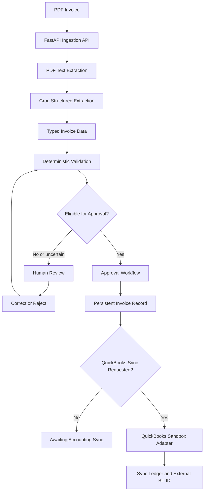

# Billy-The Invoicer 🧾

<p align="center">
  <strong>From invoice chaos to accounting clarity.</strong>
  <br/>
  AI-powered invoice processing with human oversight, intelligent validation, and accounting workflow automation.
</p>

Billy-The Invoicer transforms invoice documents into structured, reviewable accounting records. It combines AI-powered data extraction with deterministic validation, human review, persistent workflows, and QuickBooks Online sandbox integration.

The goal isn't just to extract text with an LLM. It's to build a reliable workflow around AI: identify uncertain or invalid data, let humans correct it, validate the updated record, and only then allow approved invoices to move toward accounting-system synchronization.

> **Project status:** Active development. Core extraction, review workflows, validation, persistence, regression tests, and the QuickBooks sandbox adapter are implemented. Live QuickBooks synchronization requires valid sandbox OAuth credentials and correctly configured vendor and expense-account mappings.

---

## Table of Contents

- [Overview](#overview)
- [Key Features](#key-features)
- [Architecture](#architecture)
- [Invoice Processing Workflow](#invoice-processing-workflow)
- [Technology Stack](#technology-stack)
- [Project Structure](#project-structure)
- [Getting Started](#getting-started)
- [Configuration](#configuration)
- [Running the Application](#running-the-application)
- [API Overview](#api-overview)
- [Validation and Human Review](#validation-and-human-review)
- [QuickBooks Integration](#quickbooks-integration)
- [Testing](#testing)
- [Security and Reliability](#security-and-reliability)
- [Known Limitations](#known-limitations)
- [Author](#author)

## Overview

Traditional invoice processing often involves manually reading PDFs, entering accounting fields, checking totals, resolving duplicates, and transferring approved information into accounting software.

Billy-The Invoicer automates parts of this workflow while keeping important business decisions explicit and reviewable.

The application is designed around five principles:

1. **AI extracts; deterministic code validates.** Language models propose structured fields, while application rules evaluate their consistency.
2. **Uncertainty should be visible.** Missing fields and validation failures should lead to review rather than silent acceptance.
3. **Humans retain control.** Reviewers can correct, approve, or reject invoice records.
4. **External writes require safeguards.** QuickBooks synchronization is restricted to approved invoices and uses a persistent local sync ledger.
5. **The system should be testable.** Extraction, validation, review transitions, and integration behavior are separated to support automated testing.

## Key Features

### AI-powered PDF extraction

- Accepts PDF invoice documents through the backend ingestion workflow.
- Extracts document text using PyMuPDF.
- Supports an optional Tesseract OCR fallback for scanned documents.
- Uses Groq for structured invoice extraction.
- Converts extracted fields into a typed invoice representation.

### Structured invoice data

The extraction pipeline is designed to identify accounting-relevant fields, including:

- Vendor name
- Invoice number
- Invoice date
- Currency
- Subtotal
- Tax
- Total
- QuickBooks vendor and expense-account mappings, when supplied

Extracted values are not automatically treated as proof of correctness.

### Deterministic business-rule validation

Billy-The Invoicer validates extracted records independently of the LLM.

Validation covers required fields, data consistency, duplicate detection, and available arithmetic checks. When subtotal or tax information is missing, the application can flag that the total could not be fully verified rather than incorrectly claiming the calculation succeeded.

### Human-in-the-loop review

Reviewers can inspect extracted invoice data and correct it before approval.

The review workflow supports:

- Correcting extracted fields
- Revalidating corrected records
- Detecting potential duplicates
- Approving eligible invoices
- Rejecting invoices
- Recording review activity

The backend enforces important state-transition restrictions, including preventing corrections to approved or synced invoices and rejecting incompatible state changes.

### Workflow orchestration with LangGraph

LangGraph organizes extraction, validation, and review-related workflow transitions.

The graph supports pausing for human intervention and resuming an interrupted state. PostgreSQL-backed checkpointing is used in PostgreSQL mode, while the local SQLite development path uses an in-memory graph checkpointer.

### Persistent storage

The backend uses SQLAlchemy and supports:

- PostgreSQL for the containerized environment
- SQLite for local development and smoke tests
- Persisted invoice and review state
- QuickBooks synchronization records
- A local record of external sync attempts and outcomes

### QuickBooks Online sandbox integration

The integration is designed to create a QuickBooks **Bill** for an approved invoice.

It includes OAuth token-refresh handling, bounded retries for transient failures, stable request IDs, a local synchronization ledger, and storage of the external Bill ID after successful synchronization.

**Creating a Bill does not pay it.** Live synchronization must be tested against a configured QuickBooks sandbox company.

### Metrics and operational visibility

The metrics endpoint exposes application-level information such as invoice status counts, automatic-approval rate, and average heuristic score.

## Architecture



### Architectural boundaries

| Component | Responsibility |
|---|---|
| FastAPI | HTTP API and workflow entry points |
| Extraction service | PDF text processing and structured AI extraction |
| Validation service | Deterministic business-rule checks |
| LangGraph workflow | Workflow transitions and human-intervention checkpoints |
| SQLAlchemy | Invoice, review, and sync persistence |
| QuickBooks adapter | OAuth handling, Bill creation, retries, and response handling |
| Frontend | Invoice interaction, review, approval, and rejection |
| Test suite | Regression coverage for workflows and integration behavior |

## Invoice Processing Workflow

1. **Ingest:** A user submits a PDF invoice.
2. **Extract:** The application extracts text and requests structured fields from the configured Groq model.
3. **Validate:** Deterministic rules check required fields, consistency, and potential duplicates.
4. **Review:** A reviewer inspects the record and corrects uncertain or invalid values.
5. **Approve or reject:** The backend enforces compatible state transitions.
6. **Synchronize:** An authorized user can request QuickBooks sandbox Bill creation for an approved invoice.

## Technology Stack

| Layer | Technology |
|---|---|
| Backend API | Python, FastAPI |
| Workflow orchestration | LangGraph |
| AI extraction | Groq API |
| Data validation | Pydantic and deterministic Python rules |
| PDF processing | PyMuPDF |
| OCR fallback | Tesseract OCR, when configured |
| ORM and persistence | SQLAlchemy |
| Database | PostgreSQL / SQLite |
| Frontend | Next.js, React, Tailwind CSS |
| Accounting integration | QuickBooks Online sandbox API |
| Testing | pytest |
| Dependency management | `uv` |
| Local infrastructure | Docker Compose |

## Project Structure

```text
Billy-The-Invoicer/
├── app/
│   ├── main.py
│   ├── schemas.py
│   ├── services/
│   │   ├── extractor.py
│   │   ├── validation.py
│   │   └── quickbooks.py
│   └── workflows/
│       └── invoice_graph.py
├── frontend/
│   └── app/
├── tests/
├── scripts/
├── data/
│   └── evaluation/
├── pyproject.toml
├── uv.lock
├── docker-compose.yml
├── .env.example
└── README.md
```

*The tree highlights the primary application components; filenames may evolve as development continues.*

## Getting Started

### Prerequisites

- Python version compatible with `pyproject.toml`
- [uv](https://docs.astral.sh/uv/)
- Node.js and npm
- Docker and Docker Compose for the containerized backend
- A Groq API key for AI extraction
- Tesseract OCR, if using the configured OCR fallback
- QuickBooks sandbox credentials, if testing accounting synchronization

### 1. Clone the repository

```bash
git clone https://github.com/Aryanyash16/Billy-The-Invoicer.git
cd Billy-The-Invoicer
```

### 2. Configure environment variables

```bash
cp .env.example .env
```

Edit `.env` and configure the values required by your environment. Never commit real credentials.

### 3. Install backend dependencies

```bash
uv sync
```

### 4. Start the backend

For the containerized environment:

```bash
docker compose up --build -d
docker compose ps
```

Check backend health:

```bash
curl -i http://127.0.0.1:8000/health
```

For local development, the backend can also be run with:

```bash
uv run uvicorn app.main:app --reload --port 8000
```

Use one backend instance per port and ensure your database URL matches the selected environment.

### 5. Start the frontend

Open another terminal:

```bash
cd frontend
npm install
npm run dev -- -p 3001
```

Open the application at **http://localhost:3001**.

Ensure the frontend's configured API URL matches the backend address and that CORS permits the frontend origin.

### 6. Explore the API

Open **http://localhost:8000/docs** to view the actual registered endpoints, request schemas, and response formats.

## Configuration

Use `.env.example` as the source of truth for supported configuration names.

| Variable | Purpose |
|---|---|
| `DATABASE_URL` | SQLAlchemy database connection string |
| `GROQ_API_KEY` | Authentication for the Groq extraction service |
| `QUICKBOOKS_ENV` | Must be `sandbox` for the current adapter |
| `QUICKBOOKS_CLIENT_ID` | QuickBooks OAuth application client ID |
| `QUICKBOOKS_CLIENT_SECRET` | QuickBooks OAuth application client secret |
| `QUICKBOOKS_REALM_ID` | QuickBooks company identifier |
| `QUICKBOOKS_ACCESS_TOKEN` | Sandbox OAuth access token |
| `QUICKBOOKS_REFRESH_TOKEN` | Refresh token used to obtain a new access token |
| `QUICKBOOKS_REDIRECT_URI` | Configured OAuth callback URL |

For local SQLite development, a database URL may look like:

```dotenv
DATABASE_URL=sqlite:///./invoice_ai.db
```

The Docker Compose PostgreSQL configuration uses a database hostname available within the container network. Do not use that hostname for a host-run process unless it resolves in your environment.

### QuickBooks configuration

The current adapter intentionally restricts operation to sandbox mode.

A valid OAuth connection alone is insufficient: each invoice also needs a real QuickBooks sandbox vendor mapping and expense-account mapping before Bill creation can proceed.

## Running the Application

### List invoices

```bash
curl -s http://127.0.0.1:8000/documents
```

### Inspect metrics

```bash
curl -s http://127.0.0.1:8000/metrics
```

### Request QuickBooks synchronization

```bash
curl -i -X POST \
  http://127.0.0.1:8000/integrations/quickbooks/sync/INVOICE_ID
```

Replace `INVOICE_ID` with a real invoice ID. Only test this operation after configuring sandbox credentials and mappings for an appropriate approved invoice. Confirm the HTTP method and request requirements in `/docs`.

## API Overview

| Operation | Route | Purpose |
|---|---|---|
| Health check | `GET /health` | Check backend health |
| List invoices | `GET /documents` | Retrieve persisted invoice records |
| Review or correct invoice | `/reviews/{id}` | Submit reviewer corrections |
| Approve invoice | `/reviews/{id}/approve` | Approve an eligible invoice |
| Reject invoice | `/reviews/{id}/reject` | Reject an invoice |
| QuickBooks synchronization | `/integrations/quickbooks/sync/{invoice_id}` | Request Bill creation |
| Metrics | `GET /metrics` | Retrieve processing metrics |

Consult the live OpenAPI documentation for the exact methods, request bodies, and response schemas.

## Validation and Human Review

Billy-The Invoicer deliberately separates AI extraction from business approval.

LLMs can return incomplete, inconsistent, or plausible-looking but incorrect values. Deterministic rules make important checks explicit and repeatable.

For example:

- Required fields can be checked before approval.
- Available subtotal, tax, and total values can be checked for consistency.
- Duplicate invoices can be flagged.
- Missing arithmetic inputs can produce a warning.
- Reviewer corrections can trigger validation again.

A high heuristic score is not a guarantee of correctness, and a successful structured model response does not prove that a document is a genuine tax invoice.

A booking confirmation, receipt, or payment confirmation may contain a total without being a final supplier tax invoice. Such documents should not automatically be treated as accounting-ready records.

## QuickBooks Integration

The QuickBooks adapter is separated from the invoice extraction and validation services.

### Synchronization flow

1. Load the persisted invoice.
2. Check its eligibility for synchronization.
3. Inspect the local sync ledger for an existing successful or pending attempt.
4. Validate vendor and expense-account mappings.
5. Submit a Bill-creation request using a stable request ID.
6. Handle supported transient errors and refresh an expired access token when appropriate.
7. Store the returned Bill ID and update the invoice state on success.

### Idempotency and retry behavior

The application records sync attempts locally and reuses an invoice-specific request identifier. This helps control duplicate requests and makes retries more deliberate.

However, a network timeout can occur after a remote system has accepted a write but before the client receives the response. Safe recovery depends on the external provider's actual idempotency behavior and the application's reconciliation strategy.

The local ledger alone does not guarantee exactly-once remote Bill creation. Validate successful sync, repeated sync, expired credentials, transient failures, and ambiguous outcomes against a sandbox company before production use.

## Testing

Run the complete backend test suite:

```bash
uv run pytest -q
```

Run QuickBooks and Phase 1 regression tests:

```bash
uv run pytest -q tests/test_phase1_regressions.py
```

Run validation tests:

```bash
uv run pytest -q tests/test_validation.py
```

Run workflow tests:

```bash
uv run pytest -q tests/test_invoice_graph.py
```

Check Python syntax:

```bash
uv run python -m py_compile \
  app/main.py \
  app/services/quickbooks.py \
  tests/test_phase1_regressions.py
```

Check whitespace errors:

```bash
git diff --check
```

The regression suite covers invoice-state guards, QuickBooks request-ID reuse, token-refresh behavior, transient retry behavior, and sync-ledger behavior.

Passing mocked integration tests establishes behavior under the tested scenarios. It does not establish that live QuickBooks OAuth, remote idempotency, vendor mappings, or every accounting payload has been verified against a real sandbox company.

## Security and Reliability

The project follows several important safety practices:

- **Secrets:** API keys, OAuth tokens, and database credentials belong in environment configuration, not committed source files.
- **Sandbox restriction:** The current QuickBooks adapter intentionally permits sandbox mode only.
- **Explicit state transitions:** Approved, rejected, and synced invoices have guarded operations.
- **External-write ledger:** Sync attempts and outcomes are persisted locally.
- **Bounded retries:** Transient failures are retried with a finite attempt limit.
- **Validation boundaries:** Business-rule checks run separately from LLM extraction.
- **Human oversight:** Review and approval are explicit steps.
- **Automated regression testing:** Tests help protect workflow behavior as the implementation evolves.

These controls improve reliability but do not make the system production-secure by themselves. Production deployment needs additional review of authentication and authorization, tenant isolation, file-upload limits, sensitive-data handling, log redaction, database migrations, rate limiting, observability, backups, and secrets management.

## Known Limitations

1. **Extraction accuracy:** Performance depends on document quality, layout, OCR output, model behavior, and the evaluation dataset.
2. **Arithmetic verification:** Some documents omit subtotal or tax information, limiting available checks.
3. **Accounting mappings:** Vendor and expense-account IDs must correspond to records in the connected sandbox company.
4. **QuickBooks OAuth:** Credentials, callback configuration, refresh-token persistence, and token rotation require end-to-end validation.
5. **Remote idempotency:** Ambiguous network failures require reconciliation against remote state; a local ledger cannot alone guarantee exactly-once creation.
6. **Accounting payload fidelity:** The current Bill payload uses an account-based expense line derived from the invoice total. It does not fully reconstruct supplier line items or independently represent every tax component.
7. **Document interpretation:** A booking confirmation, receipt, or payment confirmation is not necessarily a final tax invoice.
8. **Operational readiness:** Production authentication, authorization, tenant isolation, monitoring, deployment hardening, and data-retention policies need further validation.
9. **Evaluation:** Model quality should be measured against a representative, labelled invoice dataset before claiming an accuracy percentage.

## Author

**Aryan Yash**

Billy-The Invoicer explores AI-powered document processing, workflow orchestration, human-in-the-loop systems, backend engineering, and reliable integrations with external business software.

The engineering objective is simple: build AI systems that do more than generate plausible outputs—they validate results, expose uncertainty, preserve human control, and handle external side effects deliberately.

**Built with Python, FastAPI, LangGraph, Groq, PostgreSQL, Next.js, and QuickBooks Online sandbox integration.**
